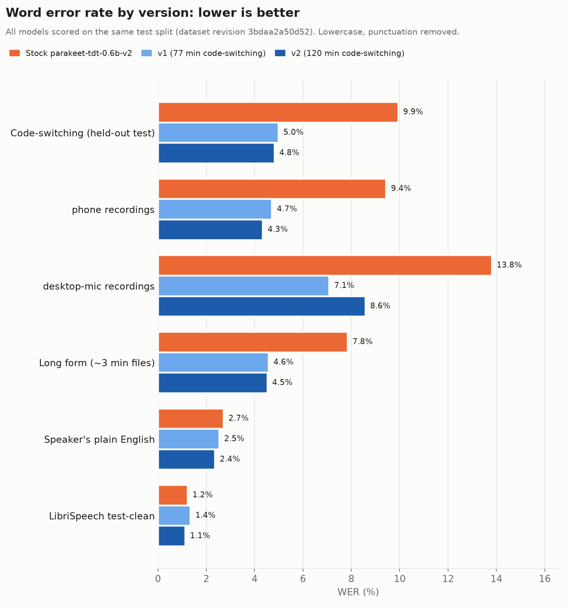
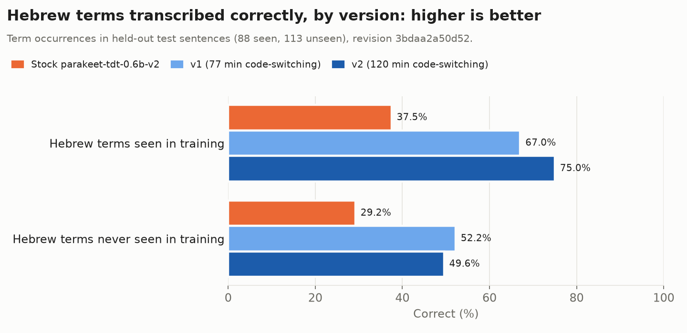

# English-Hebrew-Codeswitching-Parakeet-Finetune

Public tracker for an **English-Hebrew code-switching** fine-tune of
[`nvidia/parakeet-tdt-0.6b-v2`](https://huggingface.co/nvidia/parakeet-tdt-0.6b-v2): speech
recognition that gets the Hebrew words right when an English speaker in Israel drops them
into English: *"pick up some bamba from the makolet"*, *"I have to go to Bituach Leumi
tomorrow"*. This repo records where the project stands and links to the datasets, the
related tools and the model. The working code lives in a separate
private repository.

**Website: [hebrish.app](https://hebrish.app)**: get the Hebrish keyboard for Android and the desktop apps, see the results, and find every model, dataset and demo in one place.

**White paper:** how Jachnun v1.0 and Sabich v1.0 were trained, exported and benchmarked: [Hebrish model release 1 white paper (PDF)](https://hebrish.app/whitepaper/hebrish-release-1-whitepaper.pdf), 13 pages, 2026-10-21 ([Hebrew](https://hebrish.app/whitepaper/hebrish-release-1-whitepaper-he.pdf)). It replaces the 2026-10-19 "Hebrish v1.0" edition, whose URL redirects to it.

> **A real result:** the speaker recorded this in the [demo Space](https://huggingface.co/spaces/danielrosehill/English-Hebrew-Codeswitching-Parakeet-Demo) (2026-10-15):
>
> | | Transcript |
> |---|---|
> | Stock Parakeet v2 | I want to go to the **Micollette** today to buy my groceries. |
> | **This fine-tune** | I want to go to the **makolet** today to buy my groceries. |
>
> *Makolet* (מכולת) is the Israeli corner grocery shop. Stock v2 has never heard the word,
> so it guesses an English-looking name; the fine-tune writes the word itself.

### Try v1.0 on your own voice

**v1.0** (2026-10-19) is the first release the project stands behind. The five checkpoints
before it were a proof of concept. Testers are now wanted: English speakers in Israel who
dictate and are tired of their Hebrew words coming out wrong. Install it (see below), use it
for a while, and send what it gets wrong, or right, through [hebrish.app](https://hebrish.app)
or to [info@hebrish.app](mailto:info@hebrish.app).

### Which file should I download?

All links below are the **latest version, v1.0** (2026-10-19); they always point to the newest
release. v1.0 was benchmarked on 2026-10-19 (see **Results**); PoC-4 and PoC-5 are not
benchmarked. Earlier checkpoints, with permanent links, are under **Version history**.

| You want to… | Download | Run it with |
|---|---|---|
| **Dictate on an Android phone** | **[Q8_0 GGUF](https://huggingface.co/danielrosehill/Parakeet-TDT-0.6B-v2-English-Hebrew-Codeswitching/resolve/main/gguf/Parakeet-TDT-0.6B-v2-English-Hebrew-Codeswitching-Q8_0.gguf)** (730 MB) | [Offline Voice Input](https://play.google.com/store/apps/details?id=dev.notune.transcribe) |
| Dictate on an Android phone with little memory (≤ 4 GB RAM), or if Q8_0 is too slow | [Q4_K_M GGUF](https://huggingface.co/danielrosehill/Parakeet-TDT-0.6B-v2-English-Hebrew-Codeswitching/resolve/main/gguf/Parakeet-TDT-0.6B-v2-English-Hebrew-Codeswitching-Q4_K_M.gguf) (475 MB) | Offline Voice Input |
| **Dictate on a Linux desktop** | **[Q8_0 GGUF](https://huggingface.co/danielrosehill/Parakeet-TDT-0.6B-v2-English-Hebrew-Codeswitching/resolve/main/gguf/Parakeet-TDT-0.6B-v2-English-Hebrew-Codeswitching-Q8_0.gguf)** (730 MB) | [Handy](https://github.com/cjpais/Handy) |
| Dictate on Android, Ubuntu or Windows with the project's own app, [Parlance](https://github.com/Hebrish-ASR/Hebrish-App) | Nothing: the app downloads the model and updates it | [Parlance APK](https://github.com/Hebrish-ASR/Hebrish-App/releases/download/android-v0.1.0/Parlance-v0.1.0.apk) · [Parlance .deb](https://github.com/Hebrish-ASR/Hebrish-App/releases/download/desktop-v0.1.0/parlance_0.1.0-1_amd64.deb) · [Windows .zip](https://github.com/Hebrish-ASR/Hebrish-App/releases/download/desktop-v0.1.0/Parlance-v0.1.0-windows-x64.zip) |
| Transcribe in Python, on a GPU, or fine-tune further | [`.nemo`](https://huggingface.co/danielrosehill/Parakeet-TDT-0.6B-v2-English-Hebrew-Codeswitching/resolve/main/Parakeet-TDT-0.6B-v2-English-Hebrew-Codeswitching.nemo) (2.47 GB, full precision) | [NVIDIA NeMo](https://github.com/NVIDIA-NeMo/Speech) |

**If unsure, take Q8_0.** It is the closest to full accuracy that still runs on a phone, and
on desktop CPUs it was also *faster* than Q4_K_M: about 3× realtime against 1.4× on 8 cores.
On five held-out test clips, Q8_0 matched the `.nemo` word for word; Q4_K_M differed on one word (PoC-3, 2026-10-18). For v1.0, checked against the fp32 ONNX export, Q8_0 matched on 5 of 5 clips and Q4_K_M on 4 of 5. Speed on phones has not
been measured yet. ONNX, sherpa-onnx and MLX builds are in their own repos (links below).

## Use it on Android (5 minutes)

1. Install **Offline Voice Input** ([Google Play](https://play.google.com/store/apps/details?id=dev.notune.transcribe),
   [source](https://github.com/notune/android_transcribe_app), MIT). It is the one Android
   voice keyboard found (2026-10-15) that loads arbitrary Parakeet weights, and it runs
   fully offline.
2. On the phone, download the **[Q8_0 GGUF](https://huggingface.co/danielrosehill/Parakeet-TDT-0.6B-v2-English-Hebrew-Codeswitching/resolve/main/gguf/Parakeet-TDT-0.6B-v2-English-Hebrew-Codeswitching-Q8_0.gguf)** (730 MB, recommended). The
   **[Q4_K_M GGUF](https://huggingface.co/danielrosehill/Parakeet-TDT-0.6B-v2-English-Hebrew-Codeswitching/resolve/main/gguf/Parakeet-TDT-0.6B-v2-English-Hebrew-Codeswitching-Q4_K_M.gguf)** (475 MB) is for phones short on memory.
3. In the app, import a model, pick the downloaded `.gguf` and select it.
4. Use it in either of two ways:
   - set the app as the system **voice input**; or
   - use a keyboard whose mic key opens it: SwiftKey, HeliBoard or FlorisBoard. Gboard's
     mic button cannot hand speech to it.
5. Set the app's battery optimisation to **Unrestricted**, so Android does not kill it
   between dictations.

Both GGUFs were converted with transcribe.cpp **v0.1.3**, the version the app links. On five
held-out test clips, Q8_0 gave word-for-word the same transcripts as the PyTorch model and
Q4_K_M differed on one word (PoC-3, checked 2026-10-18). For v1.0 (2026-10-19), against the
fp32 ONNX export on five clips: Q8_0 and F16 matched on 5 of 5; Q4_K_M, ONNX int8 and
sherpa-onnx int8 on 4 of 5.

**Own app, [Parlance](https://github.com/Hebrish-ASR/Hebrish-App) (Android, 2026-10-19):** a voice
keyboard (IME) that offers stock Parakeet or this fine-tune. It downloads the sherpa-onnx int8 weights (about 660 MB) and runs them
on the phone through sherpa-onnx. It checks this model's repo for newer weights,
so a new fine-tune needs no new APK. It is meant as the companion voice input for
**HeliBoard**: HeliBoard's mic key opens it, and you are returned to HeliBoard once the text
is in. **Try it now** on the app's main screen opens a notepad with a mic button, so you can test it without any keyboard setup. **[Download the APK (v0.1.0)](https://github.com/Hebrish-ASR/Hebrish-App/releases/download/android-v0.1.0/Parlance-v0.1.0.apk)**. Not yet tested on a phone.

**Mac (Apple Silicon):** the [MLX build](https://huggingface.co/Hebrish/Jachnun-MLX) (still PoC-3, published as v3; it is re-exported after the next benchmark)
runs with `pip install parakeet-mlx` and
`parakeet-mlx audio.wav --model Hebrish/Jachnun-MLX`,
or with mlx-audio. On 10 held-out clips the PoC-3 MLX build scored the same WER as the PoC-3 `.nemo`.

**Linux and Windows, own app, [Parlance](https://github.com/Hebrish-ASR/Hebrish-App) (2026-10-19):** a
tray app for Ubuntu and Windows that runs stock Parakeet or this fine-tune. It works with any hotkey or foot pedal: tap
to start and stop, or hold for push-to-talk. It pastes at the cursor. It downloads the
sherpa-onnx int8 weights on first launch and checks for newer versions on a schedule, using
the same check as the Android app. **[Download the .deb (v0.1.0, Ubuntu 26.04 amd64)](https://github.com/Hebrish-ASR/Hebrish-App/releases/download/desktop-v0.1.0/parlance_0.1.0-1_amd64.deb)**,
then run `sudo apt install ./parlance_0.1.0-1_amd64.deb`. **[Windows zip (v0.1.0, x64)](https://github.com/Hebrish-ASR/Hebrish-App/releases/download/desktop-v0.1.0/Parlance-v0.1.0-windows-x64.zip)**: unzip it and run `Parlance.exe` (not yet tried on a real PC). Besides hotkey dictation it has a Transcribe tab for longer recordings and audio files. It replaces the earlier
Voice To Hebrish and Parakeet-Type-Ubuntu apps.

**Linux, other apps:** [Handy](https://github.com/cjpais/Handy) loads the same GGUF. Copy it into
`~/.local/share/com.pais.handy/models/` with its own file name; a name that matches a stock
catalogue file is treated as the stock model.

**Status (2026-10-19): v1.0 published and benchmarked** (339 min of code-switching): 73.3% term recall on the public benchmark, 5.1% code-switching WER on its held-out split. Retraining pauses for a while; data collection continues toward v1.1 at about 450 min.
Model: [`danielrosehill/Parakeet-TDT-0.6B-v2-English-Hebrew-Codeswitching`](https://huggingface.co/danielrosehill/Parakeet-TDT-0.6B-v2-English-Hebrew-Codeswitching)

## The problem

Stock Parakeet v2 is strong on English, but it has never seen romanized Hebrew. A Hebrew
word in English speech comes out as whatever English words sound closest. The v2 tokenizer
has no Hebrew characters, so the fix is to teach the model one **romanized spelling** per
Hebrew word, from read-aloud sentences recorded by the speaker on the phone that will run
the model.

## Scope

- **In scope:** Hebrew words inside English speech, for one speaker (an English speaker
  living in Jerusalem), on an Android phone.
- **Out of scope:** tech vocabulary, homophones, disfluency removal and paragraph
  formatting. Some recording sessions capture tech sentences too, for convenience; they
  are published in the main dataset.

## Training mix

Fine-tuning a pretrained model on code-switched speech alone badly damages its English. In
one study, Whisper-small went from 3.4% to 13.3% WER on LibriSpeech after fine-tuning on
code-switched data only. The literature consistently finds that mixing monolingual data in
works better. Mixing in as little as 10% original-domain data has been shown to cut
forgetting sharply, while too much monolingual data hurts code-switching. The target
balance, by audio duration:

| Share | Data |
|---|---|
| ~70% | Code-switching takes |
| ~20% | The speaker's own monolingual English, recorded on the same phone |
| ~10% | Public English replay (LibriSpeech or Common Voice) |

No paper gives a ratio for this exact case (one speaker, English as the main language, one
or two Hebrew words per sentence). PoC-1 to PoC-5 and v1.0 all used about 30% English
without a comparison; PoC-4 was the first run to hit the 70/20/10 target (70.8% / 19.1% /
10.1%), and PoC-5 and v1.0 kept it (v1.0: 70.2% / 19.7% / 10.0%). A comparison of 70/30, 80/20, 90/10 and 100/0 code-switching /
English remains an option for a later version.

Sources: [Liu et al. 2025](https://arxiv.org/abs/2509.24310),
[Shah et al. 2020](https://arxiv.org/abs/2006.00782),
[Pekarek Rosin & Siegert 2023](https://arxiv.org/abs/2307.07280),
[CS ASR systematic review 2025](https://arxiv.org/abs/2507.07741).

## Training data (v1.0)

Everything v1.0 was trained on, by dataset. The training job pins one revision of
`Read-Aloud-Voice-Sentences` (`550bfcaa0f84`) and adds public English replay at train time.

| Dataset | Whose | What v1.0 used from it | Licence |
|---|---|---|---|
| [`Read-Aloud-Voice-Sentences`](https://huggingface.co/datasets/danielrosehill/Read-Aloud-Voice-Sentences) | Mine | **The training source.** 3,224 code-switching clips (339.2 min): 2,785 takes from the capture app, mostly on the phone (312.4 min), and 439 recordings imported from the desktop-mic round below (26.8 min). Plus 751 clips of my own monolingual English (95.3 min). | CC-BY-4.0 |
| [`English-Hebrew-Codeswitching-Sentences`](https://huggingface.co/datasets/danielrosehill/English-Hebrew-Codeswitching-Sentences) | Mine | The code-switching phone takes, published on their own. Same audio as above, not extra data. | CC-BY-4.0 |
| [`English-Hebrew-Mixed-Sentences`](https://huggingface.co/datasets/Hebrish/English-Hebrew-Mixed-Sentences) | Mine | An earlier desktop-mic round (2025-11-17). 439 of its recordings are imported into `Read-Aloud-Voice-Sentences` with fixed transcripts, and counted there. | MIT |
| [LibriSpeech](https://huggingface.co/datasets/openslr/librispeech_asr) `train-clean-100` with [LibriSpeech-PC](https://www.openslr.org/145/) transcripts | Public | 48.5 min of English replay, so the model keeps general English. LibriSpeech-PC supplies the cased, punctuated transcripts. `test-clean` (200 utterances) is used only for evaluation. | CC-BY-4.0 |

Actual mix by duration: 70.2% code-switching, 19.7% own English, 10.0% replay (PoC-5 was
70.2 / 19.7 / 10.1). Training: a full fine-tune from stock parakeet-tdt-0.6b-v2, 20 epochs, lr
3e-5, batch 16, bf16, 41 minutes on one L40S, best epoch 18. Evaluation uses the held-out test
split of `Read-Aloud-Voice-Sentences` (387 code-switching clips, 362 held-out terms,
term-disjoint) and is never trained on.

## Links

| What | Link | Status |
|---|---|---|
| **Website**: the Hebrish keyboard and desktop apps, results, and every model, dataset and demo | [hebrish.app](https://hebrish.app) | Live, 2026-10-19 |
| **White paper**: model release 1 (Jachnun v1.0, Sabich v1.0) training pipeline and results | [hebrish-release-1-whitepaper.pdf](https://hebrish.app/whitepaper/hebrish-release-1-whitepaper.pdf) | 2026-10-21, 13 pages |
| Base model | [`nvidia/parakeet-tdt-0.6b-v2`](https://huggingface.co/nvidia/parakeet-tdt-0.6b-v2) | Upstream |
| **Fine-tuned model** | [`danielrosehill/Parakeet-TDT-0.6B-v2-English-Hebrew-Codeswitching`](https://huggingface.co/danielrosehill/Parakeet-TDT-0.6B-v2-English-Hebrew-Codeswitching) | v1.0, 2026-10-19 (benchmarked 2026-10-19): `.nemo` plus GGUF Q8_0, Q4_K_M and F16; ONNX fp32/int8 and sherpa-onnx int8 in their own repos (MLX still PoC-3). CC-BY-4.0, like the base model. The proof-of-concept checkpoints PoC-1 to PoC-5 (published as v1 to v5) are in the repo history. |
| **Release v2** (2026-10-22): Sabich v2.0, Shakshuka v2.0, Meorav v2.1 | [Sabich](https://huggingface.co/Hebrish/Sabich) · [Shakshuka](https://huggingface.co/Hebrish/Shakshuka) · [Meorav](https://huggingface.co/Hebrish/Meorav) · [release page](https://hebrish.app/releases#v2) | Published 2026-10-22, not benchmarked; access by request |
| Streaming fine-tune (experimental) | [`Hebrish/Nemotron-Speech-Streaming-EN-0.6B-English-Hebrew-Codeswitching`](https://huggingface.co/Hebrish/Nemotron-Speech-Streaming-EN-0.6B-English-Hebrew-Codeswitching) | Updated 2026-10-19 (run `r6-nemotron-en30`), benchmarked 2026-10-19 (62.2% term recall offline; 5.65% CS WER streaming at 560 ms, 5.81% offline): the same data and recipe as v1.0 on NVIDIA's streaming `nemotron-speech-streaming-en-0.6b`, to compare a second base model. Validation WER 6.3% raw, against 5.0% for v1.0 on the same validation set. `.nemo` only; NVIDIA Open Model License |
| Android app that loads it | [Offline Voice Input](https://play.google.com/store/apps/details?id=dev.notune.transcribe) ([source](https://github.com/notune/android_transcribe_app)) | Imports the GGUF; works as a voice keyboard and as the system voice input |
| Own app: Parlance (Android APK, Ubuntu .deb, Windows zip) | [GitHub: `Hebrish-App`](https://github.com/Hebrish-ASR/Hebrish-App) · [APK v0.1.0](https://github.com/Hebrish-ASR/Hebrish-App/releases/download/android-v0.1.0/Parlance-v0.1.0.apk) · [.deb v0.1.0](https://github.com/Hebrish-ASR/Hebrish-App/releases/download/desktop-v0.1.0/parlance_0.1.0-1_amd64.deb) · [Windows v0.1.0](https://github.com/Hebrish-ASR/Hebrish-App/releases/download/desktop-v0.1.0/Parlance-v0.1.0-windows-x64.zip) | v0.1.0, 2026-10-19. sherpa-onnx int8; choice of stock Parakeet or this fine-tune; downloads and updates the model from HF on its own. Android: companion IME for HeliBoard. Desktop: Qt tray app with hotkey/pedal dictation and a Transcribe tab |
| **Training data**: code-switching takes | [`danielrosehill/English-Hebrew-Codeswitching-Sentences`](https://huggingface.co/datasets/danielrosehill/English-Hebrew-Codeswitching-Sentences) | Live, synced on every push |
| Training data: takes with Yiddish words (shul, daven, freier), overlapping the code-switching set | [`Hebrish/Yiddish-Sentences`](https://huggingface.co/datasets/Hebrish/Yiddish-Sentences) | Live, 2026-10-19 |
| Training data: takes with Jewish religious terminology, Ashkenazi and Israeli forms paired, inside the code-switching set | [`Hebrish/Jewish-Religious-Terminology-Sentences`](https://huggingface.co/datasets/Hebrish/Jewish-Religious-Terminology-Sentences) | Live, 2026-10-20 |
| Every training dataset in one place | [HF collection: Parakeet V2 Fine-Tune - Training Data](https://huggingface.co/collections/Hebrish/parakeet-v2-fine-tune-training-data-6ad63c739d300685a62edb3e) | 2026-10-19 |
| **Project page**: every variant, results charts and a blog | [Space: `English-Hebrew-Codeswitching-Parakeet`](https://huggingface.co/spaces/Hebrish/English-Hebrew-Codeswitching-Parakeet) | Live, 2026-10-16. Also in the [HF collection](https://huggingface.co/collections/danielrosehill/parakeet-v2-english-hebrew-codeswitching-finetune-6ad26d79c70d28a49ed71c78) |
| **Demo**: stock v2 vs the fine-tune, side by side | [Space: `English-Hebrew-Codeswitching-Parakeet-Demo`](https://huggingface.co/spaces/danielrosehill/English-Hebrew-Codeswitching-Parakeet-Demo) | Live (ZeroGPU) |
| **Benchmark**: this model against stock Parakeet and Whisper on a frozen code-switching test set | [Space: `English-Hebrew-Codeswitching-ASR-Leaderboard`](https://huggingface.co/spaces/danielrosehill/English-Hebrew-Codeswitching-ASR-Leaderboard) ([test set](https://huggingface.co/datasets/Hebrish/English-Hebrew-Codeswitching-ASR-Benchmark), [runner](https://github.com/Hebrish/English-Hebrew-Codeswitching-ASR-Benchmark)) | Live, v1 (2026-10-15). Headline metric is Hebrew term recall |
| Browser for the training data | [Space: `English-Hebrew-Codeswitching-Browser`](https://huggingface.co/spaces/Hebrish/English-Hebrew-Codeswitching-Browser) | Live |
| **Dataset Blender**: pick datasets from the training-data collection, filter, hold out val/test (term-disjoint if wanted), set each source's share, download NeMo manifests and a reproducible recipe | [Space: `ASR-Dataset-Blender`](https://huggingface.co/spaces/danielrosehill/ASR-Dataset-Blender) ([GitHub](https://github.com/Hebrish-ASR/ASR-Dataset-Blender)) | Live, 2026-10-20. Gated datasets need sign-in and granted access |
| Earlier round: code-switched recordings (desktop mic) | [`Hebrish/English-Hebrew-Mixed-Sentences`](https://huggingface.co/datasets/Hebrish/English-Hebrew-Mixed-Sentences) | Its sentences were re-read on the phone; its recordings may join training |
| **Hebrew-Latin token classifier**: detects Hebrew words written in Latin letters inside English | [GitHub: `Hebrew-Latin-Token-Classifier`](https://github.com/Hebrish-ASR/Hebrew-Latin-Token-Classifier) | Its lexicon sets the canonical romanized spelling of every Hebrew word in the transcripts |
| Span review tool for the classifier | [Space: `hebrew-latin-span-review`](https://huggingface.co/spaces/Hebrish/hebrew-latin-span-review) | Live |
| **Error prediction**: words the speaker's dictation showed failing, candidate words split by segment (code-switching, tech, names, general English), and LLM-predicted failure scores to probe before recording | [`Hebrish/ASR-Error-Prediction`](https://huggingface.co/datasets/Hebrish/ASR-Error-Prediction) ([plan and scripts](https://github.com/danielrosehill/ASR-Mistranscription-Predictor)) | First run `haiku-r1`, 2026-10-25; predictions not yet probed |
| All takes from the capture sessions: code-switching, the speaker's monolingual English, and out-of-scope categories | [`danielrosehill/Read-Aloud-Voice-Sentences`](https://huggingface.co/datasets/danielrosehill/Read-Aloud-Voice-Sentences) | Live; source of the ~20% own-English share. The code-switching dataset above is its subset. |

## Lifecycle

| Stage | State | Notes |
|---|---|---|
| 1. Plan | Done, 2026-10-14 | Read-aloud sentences recorded on the target phone, NeMo fine-tune, on-device export |
| 2. Capture app | Done, 2026-10-14 | A phone web app in the style of Common Voice: read a sentence, record it, review, next. Takes are pushed to Hugging Face in batches. |
| 3. Data collection | **In progress** | See "Data so far" |
| 4. Baseline | Done, 2026-10-15 | Stock v2 got 28% of Hebrew term occurrences right across 615 terms |
| 5. Pilot fine-tune | Done, 2026-10-15 | PoC-1 (published as v1), 77 min of code-switching |
| 6. Retrains | v1.0 done, 2026-10-19 | Proof of concept: PoC-2 at 120 min, PoC-3 at 196 min, PoC-4 at 269 min, PoC-5 at 294 min (published as v2 to v5). Then v1.0 at 339 min, the first release the project stands behind. ~30% English each; PoC-4 the first on the 70/20/10 target. PoC-4, PoC-5 and v1.0 benchmarks pending. Retraining pauses for a while; next: v1.1 at about 450 min. |
| 7. On-device export | GGUF, ONNX, sherpa-onnx done for v1.0; MLX at PoC-3 | v1.0 exported 2026-10-19 (GGUF Q8_0/Q4_K_M/F16, ONNX fp32/int8, sherpa-onnx int8). MLX follows the next benchmark. v1.0 check against fp32 ONNX on 5 clips: Q8_0 and F16 5/5, Q4_K_M, ONNX int8 and sherpa-onnx int8 4/5. Phone test pending. |
| 8. Release | v1.0 released, 2026-10-19 | Published before its benchmark, as PoC-4 and PoC-5 were. The base model is CC-BY-4.0, so fine-tunes are published openly |
| 9. Batch releases | Release v2, 2026-10-22 | The models kept current are retrained together as one numbered release, no benchmark: Sabich v2.0, Shakshuka v2.0 and Meorav v2.1 in v2. Jachnun (this repo's code-switching-only line) stays at v1.0 until it is next retrained. [hebrish.app/releases](https://hebrish.app/releases) |

## Results

**v1.0** (run `r6-en30`, released 2026-10-19) was **benchmarked on 2026-10-19**, together
with stock v2, PoC-3 and the Nemotron run, all on v1.0's own test split (dataset revision
`550bfcaa0f84`: 387 code-switching clips, 293 occurrences of held-out terms). The whole round,
six GPU jobs on Modal, cost about US$0.50. Full write-up: [white paper (PDF)](https://hebrish.app/whitepaper/hebrish-release-1-whitepaper.pdf);
charts: [hebrish.app/benchmarks](https://hebrish.app/benchmarks).

| Test set (revision `550bfcaa0f84`) | Stock v2 | PoC-3 | **v1.0** | Nemotron (offline) | Nemotron (streaming, 560 ms) |
|---|---|---|---|---|---|
| Code-switching, held-out test (WER) | 11.3% | 6.0% | **5.1%** | 5.8% | 5.65% |
| Hebrew terms **never seen in training**: share correct | 25.9% | 45.7% | **47.8%** | 44.4% | 46.4% |
| Test terms also seen in training: share correct | 27.7% | 63.3% | **72.7%** | 68.0% | 67.3% |
| Speaker's plain English (WER) | 3.1% | 2.3% | **1.7%** | 3.3% | 3.4% |
| LibriSpeech test-clean (WER) | 1.2% | **1.0%** | 1.2% | 2.0% | 2.1% |
| Long form, ~3-minute files (WER) | 9.6% | 5.8% | **5.0%** | 5.8% | 5.85% |

On the frozen [public benchmark](https://huggingface.co/spaces/danielrosehill/English-Hebrew-Codeswitching-ASR-Leaderboard)
(round 3), v1.0 is first at **73.3%** Hebrew term recall (70.1% on unseen terms, 3.3% WER,
2.2% English control), ahead of PoC-3 at 67.4%, Nemotron at 62.2%, Whisper Large V3 at 45.9%
and stock Parakeet v2 at 32.6%. No benchmark clip is in v1.0's training manifest. The gain over
PoC-3 on held-out terms (+2.1 points, about 6 of 293) is within noise; the gain on seen terms
is not. PoC-4 and PoC-5 are not benchmarked.

The section below is PoC-3's original write-up, on its own (older, smaller) test split.

**PoC-3** (published as v3, run `r3-en30`, 2026-10-18) was trained from stock v2 on 196 min of
code-switching, 43 min of the speaker's English and 28 min of LibriSpeech replay. It took 29
minutes on one GPU. Both models were scored on PoC-3's test split (219 code-switching clips).

| Test set | Stock v2 | Fine-tune PoC-3 |
|---|---|---|
| Code-switching, held-out test (WER) | 10.9% | **5.3%** |
| Hebrew terms **never seen in training**: share correct | 27% | **48%** |
| Hebrew terms seen in training: share correct | 29% | **66%** |
| Speaker's plain English (WER) | 3.5% | **2.9%** |
| LibriSpeech test-clean (WER) | 1.2% | **1.0%** |
| Long form, ~3-minute files (WER) | 9.0% | **5.0%** |

Every version side by side, on the same test split, is under **Version history** below. On
the separate, frozen [public benchmark](https://huggingface.co/spaces/danielrosehill/English-Hebrew-Codeswitching-ASR-Leaderboard),
PoC-3 is first at 67.4% Hebrew term recall (PoC-2 65.7%, Whisper Large V3 45.9%, stock Parakeet
v2 32.6%).

WER here is lowercase with punctuation removed. English did not get worse. The jump on
unseen terms suggests the model learned how this speaker's Hebrew maps to the
romanization, not only the training words.

The baseline also shows which words matter. Across 1,139 terms in the training recordings,
stock v2 gets 258 right every time: mostly names, well-known places and words that are
already English. It never gets 706 right: challah, cheshbonit, sabich, Motzei Shabbat,
osek patur, tachana merkazit. Recording concentrates on that second group.

### Version history

Every version is re-scored on the **same** test split as the newest benchmarked one (revision
`b47310621f79`), so the rows below compare like with like. The download links at the top of
this page are always the latest version; the links in the last row stay pinned to each
version's files forever.

The checkpoints published as v1 to v5 are now called **PoC-1 to PoC-5**: the proof of
concept. **v1.0** (339 min of code-switching, released 2026-10-19) is the first release the
project stands behind. PoC-4 (269 min, HF commit `2e02382e7d`), PoC-5 (294 min, HF commit
`5522d9e86e`) and v1.0 (HF commit `ff5aaa046a`) are not in this table yet: their benchmarks
are pending. Pinned v1.0 files:
[Q8_0](https://huggingface.co/danielrosehill/Parakeet-TDT-0.6B-v2-English-Hebrew-Codeswitching/resolve/ff5aaa046a/gguf/Parakeet-TDT-0.6B-v2-English-Hebrew-Codeswitching-Q8_0.gguf) ·
[Q4_K_M](https://huggingface.co/danielrosehill/Parakeet-TDT-0.6B-v2-English-Hebrew-Codeswitching/resolve/ff5aaa046a/gguf/Parakeet-TDT-0.6B-v2-English-Hebrew-Codeswitching-Q4_K_M.gguf) ·
[.nemo](https://huggingface.co/danielrosehill/Parakeet-TDT-0.6B-v2-English-Hebrew-Codeswitching/resolve/ff5aaa046a/Parakeet-TDT-0.6B-v2-English-Hebrew-Codeswitching.nemo).

| | Stock v2 | PoC-1 (v1) | PoC-2 (v2) | **PoC-3 (v3, latest benchmarked)** |
|---|---|---|---|---|
| Released | | 2026-10-15 | 2026-10-15 | 2026-10-18 |
| Code-switching training audio | | 77 min | 120 min | 196 min |
| Code-switching WER | 10.9% | 6.0% | 5.8% | **5.3%** |
| … phone recordings | 10.7% | 6.0% | 5.6% | **5.1%** |
| … desktop-mic recordings (30 clips) | 13.8% | **7.1%** | 8.6% | 8.6% |
| Hebrew terms seen in training, correct | 29% | 57% | 60% | **66%** |
| Hebrew terms never seen in training, correct | 27% | 47% | 47% | **48%** |
| Speaker's plain English WER | 3.5% | 3.2% | **2.6%** | 2.9% |
| LibriSpeech test-clean WER | 1.2% | 1.4% | 1.1% | **1.0%** |
| Long-form WER | 9.0% | 5.9% | 5.6% | **5.0%** |
| Pinned files | | [Q8_0](https://huggingface.co/danielrosehill/Parakeet-TDT-0.6B-v2-English-Hebrew-Codeswitching/resolve/ebc0e7aff1/gguf/Parakeet-TDT-0.6B-v2-English-Hebrew-Codeswitching-Q8_0.gguf) · [Q4_K_M](https://huggingface.co/danielrosehill/Parakeet-TDT-0.6B-v2-English-Hebrew-Codeswitching/resolve/ebc0e7aff1/gguf/Parakeet-TDT-0.6B-v2-English-Hebrew-Codeswitching-Q4_K_M.gguf) · [.nemo](https://huggingface.co/danielrosehill/Parakeet-TDT-0.6B-v2-English-Hebrew-Codeswitching/resolve/ebc0e7aff1/Parakeet-TDT-0.6B-v2-English-Hebrew-Codeswitching.nemo) | [Q8_0](https://huggingface.co/danielrosehill/Parakeet-TDT-0.6B-v2-English-Hebrew-Codeswitching/resolve/e1541065f8/gguf/Parakeet-TDT-0.6B-v2-English-Hebrew-Codeswitching-Q8_0.gguf) · [Q4_K_M](https://huggingface.co/danielrosehill/Parakeet-TDT-0.6B-v2-English-Hebrew-Codeswitching/resolve/e1541065f8/gguf/Parakeet-TDT-0.6B-v2-English-Hebrew-Codeswitching-Q4_K_M.gguf) · [.nemo](https://huggingface.co/danielrosehill/Parakeet-TDT-0.6B-v2-English-Hebrew-Codeswitching/resolve/e1541065f8/Parakeet-TDT-0.6B-v2-English-Hebrew-Codeswitching.nemo) | [Q8_0](https://huggingface.co/danielrosehill/Parakeet-TDT-0.6B-v2-English-Hebrew-Codeswitching/resolve/728e6f88d4/gguf/Parakeet-TDT-0.6B-v2-English-Hebrew-Codeswitching-Q8_0.gguf) · [Q4_K_M](https://huggingface.co/danielrosehill/Parakeet-TDT-0.6B-v2-English-Hebrew-Codeswitching/resolve/728e6f88d4/gguf/Parakeet-TDT-0.6B-v2-English-Hebrew-Codeswitching-Q4_K_M.gguf) · [.nemo](https://huggingface.co/danielrosehill/Parakeet-TDT-0.6B-v2-English-Hebrew-Codeswitching/resolve/728e6f88d4/Parakeet-TDT-0.6B-v2-English-Hebrew-Codeswitching.nemo) |

**What PoC-3 changed:** 76 more minutes of code-switched audio lowered code-switching WER from
5.8% to 5.3% and long-form WER from 5.6% to 5.0%, and Hebrew words with recordings went from
60% to 66% correct. Words the model has never heard barely moved (47% → 48%, one hit out of
176). Three checkpoints now show the same thing: more takes of a word help that word, but more
audio alone does not help new words. Full per-utterance results: `evals/r3-*.json` in the
[model repo](https://huggingface.co/danielrosehill/Parakeet-TDT-0.6B-v2-English-Hebrew-Codeswitching/tree/main/evals);
the scores are also in the model card's `model-index` metadata.

### Data so far (2026-10-19, revision used for v1.0)

Code-switching takes, from the `metadata.jsonl` files on Hugging Face:

| Split | Clips | Audio | Of which from the capture app |
|---|---|---|---|
| train | 3,224 | 339 min | 312 min |
| test | 387 | 44 min | |

The rest came from the earlier desktop-mic round. The same revision has 95.3 min of the
speaker's own monolingual English. Retraining pauses for a while after v1.0; the next retrain
(v1.1) is planned at about 450 min of code-switching.

## Open questions and ideas

On 2026-10-18 the speaker recorded an 18-minute voice note of open questions and ideas for
the project ([audio](voice-notes/2026-10-18-project-notes/voice-note.mp3), [transcript](voice-notes/2026-10-18-project-notes/transcript.md)). This section is what it
raises. Nothing here is settled.

**Data to collect**

- **Messier acoustic conditions.** Most takes so far were recorded at home, but real
  dictation happens elsewhere: in the street with traffic and construction drilling, in cafés,
  at the shuk, with a baby crying nearby. A few takes with a crying baby are already
  recorded. More takes outside the home are wanted, even with no new vocabulary in them.
- **More microphones.** Every capture-app take so far comes from one phone (OnePlus Nord 3
  5G). Desktop-microphone takes will follow once the desk is set up again after a move.
- **Pronunciation variants.** Where a Hebrew word has two common pronunciations, such as the
  Diaspora (Ashkenazi) and the Israeli *Rosh Hashanah*, takes are recorded in both. Where the
  Ashkenazi form is also spelled differently in English (Shabbos for Shabbat, Tosfos for
  Tosafot), the transcript keeps the spelling that was read, and each take records the pairing
  (`variant_groups`), the spelling's tradition (`variant_spelling`) and how it was said
  (`hebrew_pronunciation`). Since 2026-10-20 the sentence bank has the missing side of 76 such
  pairs, mostly religious and Talmudic words.
- **Other speakers, later.** All training takes are still the speaker's own. Wanted later:
  female voices; other English accents common in Israel (South African, Australian, British,
  American; an Irish accent is a small minority); and Sephardi as well as Ashkenazi
  pronunciations of Hebrew. A contributor login for the capture app could follow once the
  project has some momentum.
- **Vocabulary from other people's blind spots.** Ask dictation users from other walks of
  life, for example more religious friends, which words their tools always get wrong. Gaps
  being filled now: smaller towns, moshavim and kibbutzim, street names in Jerusalem and Tel
  Aviv, public figures, politicians and new party names.
- **TTS errors as a vocabulary signal.** When a text-to-speech voice mispronounces an
  Israeli name (seen with a new political party in the speaker's AI-generated podcast), the
  word is missing from common lexicons, so it is a candidate for the sentence bank.

**Tooling**

- **Tagging after the fact.** Recording conditions (noise, crying, speaker) are tagged on the
  phone, which is awkward and often skipped. Ideas: a web tool to correct the tags
  afterwards, and an audio classifier that learns from a few tagged clips (a child crying,
  say) and finds the untagged ones.

**Open questions**

1. **How many takes does a word need?** *Hafnaya* (a medical referral) comes up all the
   time. Are 6 sentences with it enough, or 12? Should take counts be weighted by how often a
   word is actually used, so that everyday words get more takes than once-a-year ones?
2. **Should the general fixes go into every fine-tune?** Numbers written as digits and
   homophones target general weaknesses of stock v2, not code-switching. Should those
   sentences join the code-switching and tech training mixes, or would they dilute them?
3. **Speech that is not the speaker's.** In a café or the street there are often other
   conversations nearby, in Israel frequently in several languages at once. Can a fine-tune
   learn to ignore them, from loudness for example, or does that need diarization or a
   separate target-speaker model? Not a code-switching target, but a real one.
4. **Language of origin.** Some words used in English in Israel are Yiddish rather than
   Hebrew (*mamish* beside the Hebrew *mamash*), and many Hebrew words come from other
   languages. For now they are not told apart: this is a dictation tool, and its users mix
   words from several languages of origin.

**Direction**

- **Separate, targeted fine-tunes** rather than one that covers everything: code-switching
  first (the core of the project), then tech vocabulary and accent, possibly a third for
  general fixes. Training a model on a domain it does not need risks overfitting and
  forgetting for no gain. The main dataset stays one growing clip library that each
  fine-tune draws its own mix from.
- **Slower, steady updates.** PoC-1 to PoC-5 (published as v1 to v5) were the proof of concept; v1.0 is the first release. From here, about 20 to
  30 minutes of recording a week, and daily use on the phone as the real test.
- **Use cases beyond dictation:** Israeli place names spoken into navigation apps (Waze) in
  the car, medical words for patients rather than doctors, notes to self.
- **Audience:** English speakers living in Israel who already dictate and notice that every
  model, Whisper included, fails on Hebrew words, rather than local-AI specialists. Once it
  holds up in daily use, share it with immigrant organisations such as Nefesh B'Nefesh.
- **Collaboration** with the Israeli Hebrew NLP community (for example Dicta), who work on
  Hebrew LLMs, TTS and ASR. First contact has been made.
- **Apple Silicon:** done, as the MLX build (2026-10-18).

## In this repo

| Path | What |
|---|---|
| [`scripts/split_subsets.py`](scripts/split_subsets.py) | Builds category subsets (code-switching only, tech only, or any other category) from the main dataset, with the same layout, ids and train/test split. This is how the code-switching and tech datasets are derived. `--metadata-only` counts rows and minutes without downloading audio. |
| [`voice-notes/`](voice-notes/) | The speaker's voice notes about the project, each with its audio and transcript. The 2026-10-18 note is the source of **Open questions and ideas**. |
| [`sentences/`](sentences/) | The full prompt bank the speaker reads from: `sentences.jsonl` (all 14,892 prompts, with categories, target Hebrew terms, Ashkenazi / Israeli `variant_groups` and the pronunciation `pron` a prompt is written for, split and source), `code-switching.csv` (the 8,066 code-switching prompts) and `jewish-religious-terminology.csv` (the 2,411 prompts tagged `religious`, a subset of the code-switching ones), as of 2026-10-20. Licences per source are in `manifest.json`; most sentences were written by an LLM for this project and are CC-BY-4.0. |

## Design decisions

- **v2, not v3.** In the speaker's own use, v2 was more accurate than v3 for English
  dictation. v3 adds 25 languages and gives up some English accuracy.
- **Recorded on the phone that will run the model**: same microphone, rooms and posture as
  real dictation.
- **One romanized spelling per Hebrew word**, from the Hebrew-Latin-Token-Classifier
  lexicon. Variant spellings are rewritten to the canonical one, and terms are matched by
  word boundary, never by substring.
- **Transcripts are punctuated and cased**, matching v2's output style. Hebrew proper nouns
  are capitalised (Yerushalayim, Bituach Leumi).
- **The evaluation split is term-disjoint.** Held-out Hebrew terms appear only in test, so
  evaluation measures generalisation to unseen words, not memorised sentences. Per-term
  error is scored only on the held-out terms.
- **Every take is reviewed on the phone** (play, retake, delete or save) before it is
  published.

## Log

Newest first. One line per milestone.

- **2026-10-25**: Error prediction started: [`Hebrish/ASR-Error-Prediction`](https://huggingface.co/datasets/Hebrish/ASR-Error-Prediction) holds the 87 confirmed error-list words as training data and 4,746 candidate words (3,634 code-switching, 1,112 tech), each split by segment. A first Claude Haiku pass (`haiku-r1`) scored every candidate's chance of being mistranscribed and proposed 107 more, extrapolating from the confirmed errors. The scores are rankings to check against the real model before anything is recorded. [Plan](https://github.com/danielrosehill/ASR-Mistranscription-Predictor).
- **2026-10-25**: All 54 weekly Torah portions (parshiot) are now in the sentence bank: Tzav and Pinchas were the last two, 3 sentences each. The capture app has a Parshiot task that serves only those sentences (165).
- **2026-10-22**: **Release v2**, the first batch release: three models retrained together on dataset revision `110d144a` (713.9 min in the speech-recognition mix, 642.3 min of it the speaker's own takes, up from 560.5 for Sabich v1.0) and published the same day without a benchmark. [Sabich v2.0](https://huggingface.co/Hebrish/Sabich) (Parakeet TDT 0.6B v2, run `r9-all`, CC-BY-NC-4.0), [Shakshuka v2.0](https://huggingface.co/Hebrish/Shakshuka) (streaming, Nemotron, run `r9-nemotron-all`) and [Meorav v2.1](https://huggingface.co/Hebrish/Meorav) (text-to-speech, 1,103 takes, 88 min, training audio cleaned with DeepFilterNet 3; it replaced v2.0 the same day after an A/B listen). Builds are now one per device: sherpa-onnx int8 for the apps and F16 GGUF for desktop GPUs. Release page: [hebrish.app/releases](https://hebrish.app/releases#v2).
- **2026-10-22**: 117 new sentences naming the project's own models, so they can be recorded for the next release: Meorav (the text-to-speech voice, least well recognised, 34), Sabich, Shakshuka, Jachnun, Fritter, Boxty, Hebrish and Parlance, plus the bases (Parakeet, Nemotron, Qwen3-ASR, Qwen3-TTS, Canary-Qwen, asr4all). Versions are written in digits (Meorav v2.0, PoC-1). Sentences with the held-out words Qwen3 and Canary go to the test split. The bank is now 14,958 sentences.
- **2026-10-21**: **[Sabich-Canary-Qwen-2.5B v1.0](https://huggingface.co/Hebrish/Sabich-Canary-Qwen-2.5B)** released: Sabich on NVIDIA's `canary-qwen-2.5b` (LoRA + encoder fine-tune), for desktop GPUs (about 6 GB in bf16). Held-out test: 6.9% code-switching WER, 45.7% recall of unseen Hebrew terms, 2.4% on the speaker's English, 0.9% LibriSpeech, numbers 8/8. Behind Sabich-Qwen3-ASR-1.7B on code-switching, the best Sabich variant on plain English; long audio must be cut into pieces of 40 s or less.
- **2026-10-21**: **[Sabich-asr4all-S v1.0](https://huggingface.co/Hebrish/Sabich-asr4all-S)** (28M) and **[Sabich-asr4all-M v1.0](https://huggingface.co/Hebrish/Sabich-asr4all-M)** (56M) released: Sabich on the tiny streaming CTC models `futo-org/asr4all-s` / `-m`, for wearables and CPUs, with ONNX bundles. Code-switching WER 10.1% / 9.1% (stock -m 19.5%), unseen-term recall 33.9% / 36.3% (stock -m 7.5%). Numbers come out as words, and LibriSpeech regresses (6.2% / 4.0%). FUTO Model Weights License 1.0 (weights modified) plus the Hebrish terms.
- **2026-10-21**: Two more models released, trained on the kitchen-sink blend (592.4 min of the speaker's takes, 382.9 of them code-switching, plus 10% LibriSpeech-PC replay), not benchmarked yet: **[Shakshuka v1.0](https://huggingface.co/Hebrish/Shakshuka)**, the streaming line on `nvidia/nemotron-speech-streaming-en-0.6b` ([sherpa-onnx streaming build](https://huggingface.co/Hebrish/Shakshuka-sherpa-onnx-int8), [GGUF](https://huggingface.co/Hebrish/Shakshuka-GGUF)), and **[Sabich-Parakeet-110M v1.0](https://huggingface.co/Hebrish/Sabich-Parakeet-110M)**, Sabich on the 110M Parakeet for small devices ([sherpa-onnx build](https://huggingface.co/Hebrish/Sabich-Parakeet-110M-sherpa-onnx-int8), [GGUF](https://huggingface.co/Hebrish/Sabich-Parakeet-110M-GGUF)).
- **2026-10-21**: The sentence bank is now the project's own text only. The 540 Tatoeba sentences (bland, and never content-screened) are out, and 223 new homophone sentences in dictation style replace them, covering all 60 homophone sets. Takes already recorded from Tatoeba stay in the dataset. Third-party text comes in only on request, through a screened, removable path.
- **2026-10-20**: **Sabich v1.0** released, a second code-switching model: the kitchen-sink fine-tune (run `r7-all`: 560.5 min of the speaker's takes, 373.1 of them code-switching, plus tech and every other task subset, 10% LibriSpeech-PC replay). Public benchmark round 4: 73.8% term recall, 68.4% unseen, 3.27% WER, level with Jachnun v1.0 (73.3 / 70.1 / 3.32) within noise; held-out split (422 clips) CS WER 5.30% vs Jachnun 5.42%. In the Hebrish apps next to Jachnun v1.0. [Model](https://huggingface.co/Hebrish/Parakeet-TDT-0.6B-v2-English-Hebrew-Codeswitching-All-Subsets) · [app build](https://huggingface.co/Hebrish/Sabich-sherpa-onnx-int8) · [training blend](https://huggingface.co/datasets/Hebrish/Parakeet-V2-Blend-All).
- **2026-10-20**: **[ASR Dataset Blender](https://huggingface.co/spaces/danielrosehill/ASR-Dataset-Blender)** released ([GitHub](https://github.com/Hebrish-ASR/ASR-Dataset-Blender)): builds a training blend from the project's datasets (filters, de-duplication, term-disjoint hold-out, per-source shares or caps) and downloads it as NeMo manifests, a NeMo Lhotse `input_cfg.yaml` and a recipe pinned to dataset commits. It processes only metadata, so it runs on free CPU.
- **2026-10-20**: Jewish religious terminology is bracketed as its own category, `religious` (2,411 prompts; 830 of the speaker's recorded takes, 96.5 min), always also code-switching, so it stays in the next version's training. Ashkenazi and Israeli forms of the same word are paired: 76 words with two English spellings (Shabbat / Shabbos, brit / bris, Tosafot / Tosfos, Bereishit / Bereishis) and 26 that differ only in stress (Torah, Pesach). A coverage check found the Ashkenazi form recorded for 7 of the 76 words, so the bank gains 295 sentences with the missing side, pre-tagged with the pronunciation to read. Written and reviewed by separate Claude subagents. Published as **[Jewish-Religious-Terminology-Sentences](https://huggingface.co/datasets/Hebrish/Jewish-Religious-Terminology-Sentences)** (795 takes, 96.8 min). The Ashkenazi forms of pair words are exempt from the term hold-out, so they train; one sentence each stays in test.
- **2026-10-19**: **v1.0 benchmarked** for about US$0.50 of Modal GPU time: 73.3% term recall on the public benchmark (round 3), 5.1% CS WER on its held-out split (stock 11.3%, PoC-3 6.0%). Nemotron: 62.2% offline; streaming at 560 ms 5.65% CS WER, the same as offline (5.81%). [White paper (PDF)](https://hebrish.app/whitepaper/hebrish-v1.0-whitepaper.pdf) and [hebrish.app/benchmarks](https://hebrish.app/benchmarks).
- **2026-10-19**: **v1.0 released** (run `r6-en30`, 339 min of code-switching, up from 294), the first release the project stands behind; the checkpoints published as v1 to v5 are renamed **PoC-1 to PoC-5**. Mix 70.2% / 19.7% / 10.0%, best epoch 18 of 20, 41 minutes on one L40S, validation WER 5.0% raw (new validation set, not comparable). Not benchmarked. `.nemo`, GGUF Q8_0/Q4_K_M/F16, ONNX fp32/int8 and sherpa-onnx int8 refreshed (MLX stays PoC-3); demo Space, project page and hebrish.app updated. The streaming [Nemotron fine-tune](https://huggingface.co/Hebrish/Nemotron-Speech-Streaming-EN-0.6B-English-Hebrew-Codeswitching) is retrained on the same data (`r6-nemotron-en30`, validation WER 6.3% raw, not benchmarked). Retraining pauses for a while; next is v1.1 at about 450 min. Testers wanted.
- **2026-10-19**: Sentence bank grows from 12,647 to 14,361 prompts: niche halakha terms, famous rabbis, all the weekly Torah portions and books, Jerusalem and Tel Aviv streets and neighbourhoods, greetings, Israeli brands and products, everyday words, Anglo residential buildings, car rental and sharing, and 67 names from 20 Times of Israel and Jerusalem Post stories of 18 and 19 October. Companion Hebrew words were spread over 700 less-used words to cut repetition. Written and reviewed by separate Claude subagents.
- **2026-10-19**: Takes with Yiddish words are tagged `yiddish` and mirrored to **[Yiddish-Sentences](https://huggingface.co/datasets/Hebrish/Yiddish-Sentences)**. Words used in both Hebrew and Yiddish (freier, tachles) stay in the code-switching set as well. The training datasets are collected in one [HF collection](https://huggingface.co/collections/Hebrish/parakeet-v2-fine-tune-training-data-6ad63c739d300685a62edb3e).
- **2026-10-19**: Project website **[hebrish.app](https://hebrish.app)** live: the Hebrish keyboard for Android and the desktop apps, the results, and links to every model, dataset and demo.
- **2026-10-19**: The own apps are now **[Parlance](https://github.com/Hebrish-ASR/Hebrish-App)** (Android v0.1.0, desktop v0.1.0 for Ubuntu and Windows), replacing Voice To Hebrish and Parakeet-Type-Ubuntu. Parlance offers a choice of model: stock Parakeet TDT 0.6B v2 or this fine-tune, with technical-vocabulary and personal-voice fine-tunes to follow.
- **2026-10-18**: **v5 released** (run `r5-en30`, 294 min of code-switching, up from 269), trained early, before the 360-min checkpoint, and published before its benchmark, like v4. Validation WER 4.9% raw (v4: 5.0%, different validation sets). `.nemo`, GGUF, ONNX and sherpa-onnx refreshed; the apps pick it up from `sherpa-onnx/int8/`. Alongside it, the first **second base model**: the same data and recipe on NVIDIA's streaming [`nemotron-speech-streaming-en-0.6b`](https://huggingface.co/Hebrish/Nemotron-Speech-Streaming-EN-0.6B-English-Hebrew-Codeswitching) (validation WER 6.4%, not benchmarked; its point is live, streaming text).
- **2026-10-18**: The two apps merge into one repo, Voice To Hebrish (a working title, and a gag; since 2026-10-19 [Parlance](https://github.com/Hebrish-ASR/Hebrish-App)): Android v0.6.0 adds a no-setup **Try it** notepad and pads takes with silence, and desktop v0.2.0 moves to Qt, adds **Windows**, a Transcribe tab for long-form audio, and an About tab with these benchmarks.
- **2026-10-18**: Sentence bank grows from 10,277 to 11,163 prompts: more modern Israeli first names and surnames, terms from the current news (election, institutions), and a gap pass over domains not yet covered (driving, weather, banking and tax, family law, insurance, weddings, mourning, elder care, pregnancy, sport, travel, pets, university), plus top-up sentences for 43 thin terms. Written and reviewed by separate Claude subagents.
- **2026-10-18**: Codeswitch Dictation v0.1.0 (now [Parlance](https://github.com/Hebrish-ASR/Hebrish-App/tree/main/desktop)): a proof-of-concept Ubuntu desktop app (.deb) that runs only this model through sherpa-onnx. It downloads the weights on first run and checks for new versions. It replaces Parakeet-Type-Ubuntu for this model.
- **2026-10-18**: **v4 released** (run `r4-en30`, 269 min of code-switching, up from 196): the first run on the 70/20/10 mix target (70.8% / 19.1% / 10.1%), 20 epochs on one L40S. Published before its benchmark, so no test-set numbers yet; v3's remain the latest measured. `.nemo`, GGUF, ONNX and sherpa-onnx refreshed to v4, as are the demo and project Spaces; MLX stays v3 until the benchmark.

- **2026-10-18**: Voice note of open questions and ideas ([audio and transcript](voice-notes/2026-10-18-project-notes/)), summarised under **Open questions and ideas**: messier recording conditions, more microphones and speakers, how many takes a word needs, and whether general fixes belong in every fine-tune.
- **2026-10-18**: v3 for Apple Silicon: [MLX build](https://huggingface.co/Hebrish/Jachnun-MLX) for parakeet-mlx and mlx-audio, the same WER as the `.nemo` on 10 held-out clips.
- **2026-10-18**: Sentence bank grows from 9,735 to 10,277 prompts: an everyday-vocabulary pack (home repairs, parenting and gan, work, renting, produce, army reserves, the missing Hebrew months), whole Hebrew reactions and fillers (legamrei, rak rega, ein li musag), and the bank's first short utterances of 2 to 4 words.
- **2026-10-18**: Codeswitch Voice v0.1.0 (now [Parlance](https://github.com/Hebrish-ASR/Hebrish-App/tree/main/android)): a proof-of-concept Android voice keyboard (APK) that runs v3 on-device through sherpa-onnx, as the companion voice input for HeliBoard.
- **2026-10-18**: **v3 released** (run `r3-en30`, 196 min of code-switching): code-switching WER 5.3% (stock v2 10.9%, v2 5.8%), Hebrew terms with recordings 66% correct (v2 60%), no loss of English. GGUF, ONNX and sherpa-onnx exports refreshed; the model card now carries `model-index` eval metadata. First on the public benchmark at 67.4% term recall.
- **2026-10-17**: Sentence bank grows from 9,443 to 9,735 prompts with a medical pack: health-fund admin words, medical terms, hospitals and 58 Israeli drug trade names (Acamol-family, Moxypen, Lorivan…), 292 sentences. Published takes gain a `prompt_origin` column (manual / dataset / generated).
- **2026-10-17**: Sentence bank grows from 8,325 to 9,443 prompts with a tech pack of 377 terms (cloud-native projects, AI model families, developer tools and libraries), for a planned second fine-tune on tech vocabulary and accent. These sentences are English only, with no code-switching. Exported to `sentences/`.
- **2026-10-17**: Sentence bank grows from 7,697 to 8,325 prompts with a Jewish observance pack (kashrut and certification bodies, Shabbat, Daf Yomi and Torah study, prayer, holiday prep), weighted to everyday words rather than once-a-year ones. New subset dataset [`General-English-Sentences`](https://huggingface.co/datasets/danielrosehill/General-English-Sentences): plain English takes with no Hebrew, names or tech, for accent-only fine-tuning.
- **2026-10-16**: Project page Space live: links to every published format (.nemo, GGUF, ONNX, sherpa-onnx), interactive results charts and a blog, added to the HF collection.
- **2026-10-16**: Sentence bank grows from 5,752 to 7,697 prompts with five vocabulary packs: Jerusalem and Tel Aviv places, hospitals and health words, everyday code-switching gaps, second-tier towns, moshavim and kibbutzim, Israeli brands and acronyms (El Al, Arkia, Israir), and 2026 election parties, politicians and media names. Exported to `sentences/`.
- **2026-10-15**: Public benchmark released: a frozen code-switching test set, runner and leaderboard Space. It scores this fine-tune against stock Parakeet and Whisper models.
- **2026-10-15**: v2 published (120 min of code-switching): code-switching WER 9.9% → 4.8% and unseen Hebrew terms 29% → 50% against stock v2, no English regression. HF now lists it as a fine-tune of v2.
- **2026-10-15**: Next retrain (v2) set for 120 min of code-switching training audio; 108 min
  so far (90%). Subset script and sentence bank published here; model card has a roadmap.
- **2026-10-15**: Demo Space live. Published transcripts normalised: 10 rows fixed,
  including a spelling-rewrite bug that turned "more" into "moreh". 301 missing Israeli-life
  terms found by a gap review and 868 sentences written for them. Recording now favours
  the words stock v2 gets wrong.
- **2026-10-15**: Baseline measured and first fine-tune published. Unseen Hebrew terms
  correct went from 30% to 55%, code-switching WER from 9.5% to 4.5%, with no English
  regression.
- **2026-10-15**: Training mix set from the code-switching literature: about 70%
  code-switching and 30% monolingual English.
- **2026-10-15**: Scope narrowed to code-switching; tech vocabulary dropped. Repo renamed from `Parakeet-V2-Personal-Finetune-Lifecycle`.
- **2026-10-15**: First data check: enough for a pilot. A capture-app button to record more
  sentences for a chosen term.
- **2026-10-14**: Code-switching subset dataset and its browser Space.
- **2026-10-14**: Capture app live; main dataset created and receiving takes.
- **2026-10-14**: Project planned.
