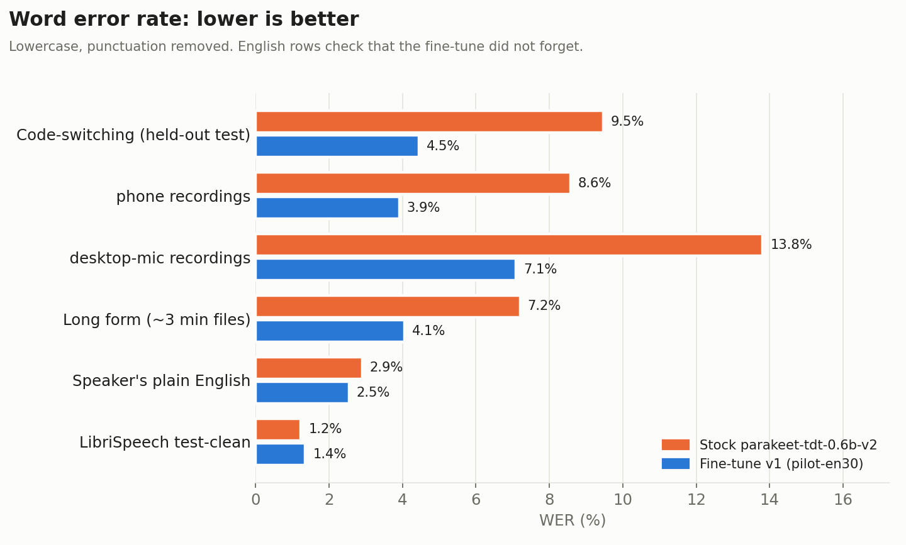
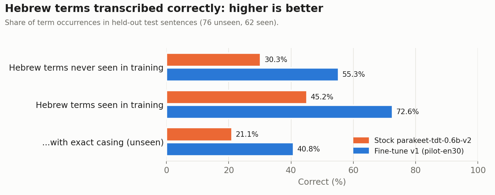
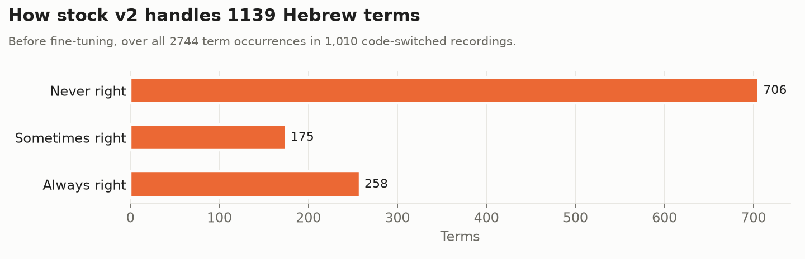

# English-Hebrew-Codeswitching-Parakeet-Finetune

Public tracker for an **English-Hebrew code-switching** fine-tune of
[`nvidia/parakeet-tdt-0.6b-v2`](https://huggingface.co/nvidia/parakeet-tdt-0.6b-v2): speech
recognition that gets the Hebrew words right when an English speaker in Israel drops them
into English: *"pick up some bamba from the makolet"*, *"I have to go to Bituach Leumi
tomorrow"*. This repo records where the project stands and links to the datasets, the
related tools and, once it is released, the model. The working code lives in a separate
private repository.

> **A real result:** the speaker recorded this in the [demo Space](https://huggingface.co/spaces/danielrosehill/English-Hebrew-Codeswitching-Parakeet-Demo) (2026-10-15):
>
> | | Transcript |
> |---|---|
> | Stock Parakeet v2 | I want to go to the **Micollette** today to buy my groceries. |
> | **This fine-tune** | I want to go to the **makolet** today to buy my groceries. |
>
> *Makolet* (מכולת) is the Israeli corner grocery shop. Stock v2 has never heard the word,
> so it guesses an English-looking name; the fine-tune writes the word itself.

### Which file should I download?

| You want to… | Download | Run it with |
|---|---|---|
| **Dictate on an Android phone** | **[Q8_0 GGUF](https://huggingface.co/danielrosehill/Parakeet-TDT-0.6B-v2-English-Hebrew-Codeswitching/resolve/main/gguf/Parakeet-TDT-0.6B-v2-English-Hebrew-Codeswitching-Q8_0.gguf)** (730 MB) | [Offline Voice Input](https://play.google.com/store/apps/details?id=dev.notune.transcribe) |
| Dictate on an Android phone with little memory (≤ 4 GB RAM), or if Q8_0 is too slow | [Q4_K_M GGUF](https://huggingface.co/danielrosehill/Parakeet-TDT-0.6B-v2-English-Hebrew-Codeswitching/resolve/main/gguf/Parakeet-TDT-0.6B-v2-English-Hebrew-Codeswitching-Q4_K_M.gguf) (475 MB) | Offline Voice Input |
| **Dictate on a Linux desktop** | **[Q8_0 GGUF](https://huggingface.co/danielrosehill/Parakeet-TDT-0.6B-v2-English-Hebrew-Codeswitching/resolve/main/gguf/Parakeet-TDT-0.6B-v2-English-Hebrew-Codeswitching-Q8_0.gguf)** (730 MB) | [Handy](https://github.com/cjpais/Handy) |
| Transcribe in Python, on a GPU, or fine-tune further | [`.nemo`](https://huggingface.co/danielrosehill/Parakeet-TDT-0.6B-v2-English-Hebrew-Codeswitching/resolve/main/Parakeet-TDT-0.6B-v2-English-Hebrew-Codeswitching.nemo) (2.47 GB, full precision) | [NVIDIA NeMo](https://github.com/NVIDIA-NeMo/Speech) |

**If unsure, take Q8_0.** It is the closest to full accuracy that still runs on a phone, and
on desktop CPUs it was also *faster* than Q4_K_M: about 3× realtime against 1.4× on 8 cores.
Both gave identical transcripts to the `.nemo` on the test clips. Speed on phones has not
been measured yet. ONNX exports for sherpa-onnx apps (Voxtype, Dictus) are not published
yet.

## Use it on Android (5 minutes)

1. Install **Offline Voice Input** ([Google Play](https://play.google.com/store/apps/details?id=dev.notune.transcribe),
   [source](https://github.com/notune/android_transcribe_app), MIT). It is the one Android
   voice keyboard found (2026-10-15) that loads arbitrary Parakeet weights, and it runs
   fully offline.
2. On the phone, download the **[Q8_0 GGUF](https://huggingface.co/danielrosehill/Parakeet-TDT-0.6B-v2-English-Hebrew-Codeswitching/resolve/main/gguf/Parakeet-TDT-0.6B-v2-English-Hebrew-Codeswitching-Q8_0.gguf)** (730 MB, recommended). The
   **[Q4_K_M GGUF](https://huggingface.co/danielrosehill/Parakeet-TDT-0.6B-v2-English-Hebrew-Codeswitching/resolve/main/gguf/Parakeet-TDT-0.6B-v2-English-Hebrew-Codeswitching-Q4_K_M.gguf)** (475 MB) is for phones short on memory.
3. In the app, import a model, pick the downloaded `.gguf` and select it.
4. Use it in either of two ways:
   - set the app as the system **voice input**; or
   - use a keyboard whose mic key opens it: SwiftKey, HeliBoard or FlorisBoard. Gboard's
     mic button cannot hand speech to it.
5. Set the app's battery optimisation to **Unrestricted**, so Android does not kill it
   between dictations.

Both GGUFs were converted with transcribe.cpp **v0.1.3**, the version the app links. On five
held-out test clips they gave word-for-word the same transcripts as the PyTorch model
(checked 2026-10-15).

**Linux:** [Handy](https://github.com/cjpais/Handy) loads the same GGUF. Copy it into
`~/.config/com.pais.handy/models/` with its own file name; a name that matches a stock
catalogue file is treated as the stock model.

**Status (2026-10-15): first fine-tune published.** Data collection continues.
Model: [`danielrosehill/Parakeet-TDT-0.6B-v2-English-Hebrew-Codeswitching`](https://huggingface.co/danielrosehill/Parakeet-TDT-0.6B-v2-English-Hebrew-Codeswitching)

## The problem

Stock Parakeet v2 is strong on English, but it has never seen romanized Hebrew. A Hebrew
word in English speech comes out as whatever English words sound closest. The v2 tokenizer
has no Hebrew characters, so the fix is to teach the model one **romanized spelling** per
Hebrew word, from read-aloud sentences recorded by the speaker on the phone that will run
the model.

## Scope

- **In scope:** Hebrew words inside English speech, for one speaker (an English speaker
  living in Jerusalem), on an Android phone.
- **Out of scope:** tech vocabulary, homophones, disfluency removal and paragraph
  formatting. Some recording sessions capture tech sentences too, for convenience; they
  are published in the main dataset.

## Training mix

Fine-tuning a pretrained model on code-switched speech alone badly damages its English. In
one study, Whisper-small went from 3.4% to 13.3% WER on LibriSpeech after fine-tuning on
code-switched data only. The literature consistently finds that mixing monolingual data in
works better. Mixing in as little as 10% original-domain data has been shown to cut
forgetting sharply, while too much monolingual data hurts code-switching. The target
balance, by audio duration:

| Share | Data |
|---|---|
| ~70% | Code-switching takes |
| ~20% | The speaker's own monolingual English, recorded on the same phone |
| ~10% | Public English replay (LibriSpeech or Common Voice) |

No paper gives a ratio for this exact case (one speaker, English as the main language, one
or two Hebrew words per sentence), so the pilot compares 0%, 15% and 30% English and keeps
the best on both test sets: held-out code-switching and general English.

Sources: [Liu et al. 2025](https://arxiv.org/abs/2509.24310),
[Shah et al. 2020](https://arxiv.org/abs/2006.00782),
[Pekarek Rosin & Siegert 2023](https://arxiv.org/abs/2307.07280),
[CS ASR systematic review 2025](https://arxiv.org/abs/2507.07741).

## Links

| What | Link | Status |
|---|---|---|
| Base model | [`nvidia/parakeet-tdt-0.6b-v2`](https://huggingface.co/nvidia/parakeet-tdt-0.6b-v2) | Upstream |
| **Fine-tuned model** | [`danielrosehill/Parakeet-TDT-0.6B-v2-English-Hebrew-Codeswitching`](https://huggingface.co/danielrosehill/Parakeet-TDT-0.6B-v2-English-Hebrew-Codeswitching) | v1 pilot, 2026-10-15: `.nemo` plus GGUF Q8_0 and Q4_K_M. CC-BY-4.0, like the base model. |
| Android app that loads it | [Offline Voice Input](https://play.google.com/store/apps/details?id=dev.notune.transcribe) ([source](https://github.com/notune/android_transcribe_app)) | Imports the GGUF; works as a voice keyboard and as the system voice input |
| **Training data**: code-switching takes | [`danielrosehill/English-Hebrew-Codeswitching-Sentences`](https://huggingface.co/datasets/danielrosehill/English-Hebrew-Codeswitching-Sentences) | Live, synced on every push |
| **Demo**: stock v2 vs the fine-tune, side by side | [Space: `English-Hebrew-Codeswitching-Parakeet-Demo`](https://huggingface.co/spaces/danielrosehill/English-Hebrew-Codeswitching-Parakeet-Demo) | Live (ZeroGPU) |
| Browser for the training data | [Space: `English-Hebrew-Codeswitching-Browser`](https://huggingface.co/spaces/danielrosehill/English-Hebrew-Codeswitching-Browser) | Live |
| Earlier round: code-switched recordings (desktop mic) | [`danielrosehill/English-Hebrew-Mixed-Sentences`](https://huggingface.co/datasets/danielrosehill/English-Hebrew-Mixed-Sentences) | Its sentences were re-read on the phone; its recordings may join training |
| **Hebrew-Latin token classifier**: detects Hebrew words written in Latin letters inside English | [GitHub: `Hebrew-Latin-Token-Classifier`](https://github.com/danielrosehill/Hebrew-Latin-Token-Classifier) | Its lexicon sets the canonical romanized spelling of every Hebrew word in the transcripts |
| Span review tool for the classifier | [Space: `hebrew-latin-span-review`](https://huggingface.co/spaces/danielrosehill/hebrew-latin-span-review) | Live |
| All takes from the capture sessions: code-switching, the speaker's monolingual English, and out-of-scope categories | [`danielrosehill/Read-Aloud-Voice-Sentences`](https://huggingface.co/datasets/danielrosehill/Read-Aloud-Voice-Sentences) | Live; source of the ~20% own-English share. The code-switching dataset above is its subset. |

## Lifecycle

| Stage | State | Notes |
|---|---|---|
| 1. Plan | Done, 2026-10-14 | Read-aloud sentences recorded on the target phone, NeMo fine-tune, on-device export |
| 2. Capture app | Done, 2026-10-14 | A phone web app in the style of Common Voice: read a sentence, record it, review, next. Takes are pushed to Hugging Face in batches. |
| 3. Data collection | **In progress** | See "Data so far" |
| 4. Baseline | Done, 2026-10-15 | Stock v2 got 28% of Hebrew term occurrences right across 615 terms |
| 5. Pilot fine-tune | Done, 2026-10-15 | See "Results". The 0% and 15% English comparison is still to run. |
| 6. Full fine-tune | Not started | At the mix chosen by the pilot |
| 7. On-device export | GGUF done, 2026-10-15 | Q8_0 and Q4_K_M via transcribe.cpp v0.1.3; identical transcripts to PyTorch on 5 test clips. Phone test pending. |
| 8. Release | Pilot released | The base model is CC-BY-4.0, so fine-tunes are published openly |

## Results

The first fine-tune, **v1** (run `pilot-en30`, 2026-10-15), was trained on 77 min of code-switching,
22 min of the speaker's English and 11 min of LibriSpeech replay. It took 19 minutes on one
GPU.

| Test set | Stock v2 | Fine-tune |
|---|---|---|
| Code-switching, held-out test (WER) | 9.5% | **4.5%** |
| Hebrew terms **never seen in training**: share correct | 30% | **55%** |
| Hebrew terms seen in training: share correct | 45% | **73%** |
| Speaker's plain English (WER) | 2.9% | 2.5% |
| LibriSpeech test-clean (WER) | 1.2% | 1.4% |
| Long form, ~3-minute files (WER) | 7.2% | **4.1%** |

WER here is lowercase with punctuation removed. English did not get worse. The jump on
unseen terms suggests the model learned how this speaker's Hebrew maps to the
romanization, not only the training words.

The baseline also showed which words matter. Stock v2 already gets 165 of 615 terms right
every time: mostly names, well-known places and words that are already English (Shabbat,
Pesach, Bamba). It never gets 390 right: Misrad Hapnim, Bituach Leumi, tzaharon, rofe
mishpacha, Motzei Shabbat, Pikud Haoref. Recording now concentrates on the second group.

### Data so far (2026-10-15)

Code-switching takes, from the `metadata.jsonl` files on Hugging Face:

| Split | Clips | Audio | Of which recorded on the phone |
|---|---|---|---|
| train | 925 | 82 min | 457 clips, 53 min |
| test | 85 | 10 min | 55 clips, 8 min |

The rest came from the earlier desktop-mic round. The same split has 26 min of the speaker's
own monolingual English (24% of the combined audio), but only 4 min of it is plain
English; the rest is tech and names sentences. So plain English is now a recording
priority. 529 distinct Hebrew terms appear in
train, but most only once, so recording is now weighted toward terms with only one or two
takes.

## Design decisions

- **v2, not v3.** In the speaker's own use, v2 was more accurate than v3 for English
  dictation. v3 adds 25 languages and gives up some English accuracy.
- **Recorded on the phone that will run the model**: same microphone, rooms and posture as
  real dictation.
- **One romanized spelling per Hebrew word**, from the Hebrew-Latin-Token-Classifier
  lexicon. Variant spellings are rewritten to the canonical one, and terms are matched by
  word boundary, never by substring.
- **Transcripts are punctuated and cased**, matching v2's output style. Hebrew proper nouns
  are capitalised (Yerushalayim, Bituach Leumi).
- **The evaluation split is term-disjoint.** Held-out Hebrew terms appear only in test, so
  evaluation measures generalisation to unseen words, not memorised sentences. Per-term
  error is scored only on the held-out terms.
- **Every take is reviewed on the phone** (play, retake, delete or save) before it is
  published.

## Log

Newest first. One line per milestone.

- **2026-10-15**: Demo Space live. Published transcripts normalised: 10 rows fixed,
  including a spelling-rewrite bug that turned "more" into "moreh". 301 missing Israeli-life
  terms found by a gap review and 868 sentences written for them. Recording now favours
  the words stock v2 gets wrong.
- **2026-10-15**: Baseline measured and first fine-tune published. Unseen Hebrew terms
  correct went from 30% to 55%, code-switching WER from 9.5% to 4.5%, with no English
  regression.
- **2026-10-15**: Training mix set from the code-switching literature: about 70%
  code-switching and 30% monolingual English.
- **2026-10-15**: Scope narrowed to code-switching; tech vocabulary dropped. Repo renamed from `Parakeet-V2-Personal-Finetune-Lifecycle`.
- **2026-10-15**: First data check: enough for a pilot. A capture-app button to record more
  sentences for a chosen term.
- **2026-10-14**: Code-switching subset dataset and its browser Space.
- **2026-10-14**: Capture app live; main dataset created and receiving takes.
- **2026-10-14**: Project planned.
